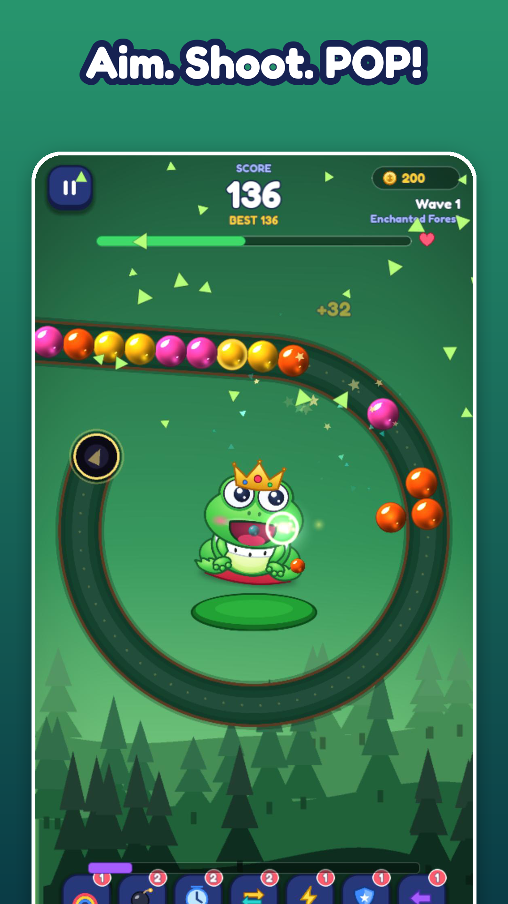

# FrogPop: Bubble Quest

*Poyraz Yazılım - `com.poyraz.frogpop` - Godot 4.7 (GDScript) - portrait mobile (Android / iOS)*

**EN** An original, fully offline, endless bubble-chain shooter. Aim with a touch, shoot bubbles from the mouth of an animated frog mascot, match 3+ colours, trigger chain reactions and survive an endless sequence of generated routes and worlds. **TR** Tamamen çevrim dışı, özgün ve sonsuz bir balon zinciri atıcısı: dokunarak nişan al, animasyonlu kurbağanın ağzından balon fırlat, 3+ aynı rengi eşleştir, zincir reaksiyonları yap.



## Features / Özellikler
- Endless waves with a smooth, bounded difficulty curve (speed, length, 4 -> 8 colours, stones, bombs, golden bubbles), bot-verified fairness; boss route every 10 waves.
- 9 procedurally generated route families (circle, spiral, snake, wave, double bend, labyrinth, heart, figure-eight with crossing, flower boss) validated for playability (curvature, overlap, reachability, frog clearance).
- Pure GDScript simulation core (`scripts/gameplay/`, fixed 1/120 s step): arc-length chain, pusher-front physics, gap + magnet pull-back, chain reactions, swept-ray shots (no tunnelling), 7 power-ups.
- Animated layered frog (12 animations, eye tracking) with 5 costumes (Royal, Wizard, Ninja, Pirate, Galaxy), glossy bubble art with colour-blind symbols, pooled particles, shader backgrounds.
- 10 worlds x 3 background variations, data-driven (`data/themes/*.json`), music per world (synthesised), world transitions.
- Modes: Endless Classic, Time Attack, Zen, Daily Challenge. Daily gift, daily/weekly missions, 20 achievements, stats, shop, PRO screen.
- Local JSON save with checksum + rolling backup + validation; clock-rollback guard for daily rewards.
- TR / EN (CSV driven), Low/Medium/High quality, safe-area aware, any aspect ratio.
- Honest monetisation layer: AdMob / store plugins are detected at runtime; without them ads and purchases are "unavailable" (no fake purchases). A clearly labelled *TEST AD* exists only in debug builds.

## Run / Test
```bash
godot --path .                                         # run (Godot 4.7.2 stable)
godot --headless --path . res://tests/test_runner.tscn  # full test-suite (exit code 0 = pass)
godot --headless --path . res://tests/test_runner.tscn -- --filter=t_game
tools/shot.sh out.png 120 --screen=game --autoplay     # offscreen screenshot via Movie Maker
```
Test suites: routes, chain physics, game rules, power-ups, scoring, difficulty, 1000-wave simulation, save/backup/corruption, daily reward + clock rollback, PRO, ad rules, localisation completeness, every screen at 4 aspect ratios, every mode auto-played, frog animations, performance budget.

## Build (Android / iOS)
See `docs/RELEASE.md`. Secrets (keystore, passwords) live **outside** the repo (`~/Documents/frogpop-keys/`), passed via `GODOT_ANDROID_KEYSTORE_*` environment variables (`tools/android_env.sh`). `tools/build_android.sh` produces the signed release APK + AAB and a debug APK.

## Ads & purchases
Add the native plugins described in `docs/MONETIZATION.md` (AdMob: `PoingGodotAdMob`; billing: `GodotGooglePlayBilling`; iOS: `InAppStore`). Product ids: `frogpop_pro_monthly`, `frogpop_pro_yearly`, `frogpop_pro_lifetime`, `frogpop_remove_ads`. Replace the Google *test* ad unit ids in `data/config/monetization.json` for release.

## Legal
[Privacy Policy](PRIVACY_POLICY.md) - [Terms of Service](TERMS_OF_SERVICE.md) - [Third-party notices](THIRD_PARTY_NOTICES.md) - [License](LICENSE) (all rights reserved). Hosted pages (GitHub Pages, from `site/`): https://omer-poyraz.github.io/frogpop-bubble-quest/privacy-policy/

Contact: Poyraz Yazılım - omerr.poyrazz@gmail.com
